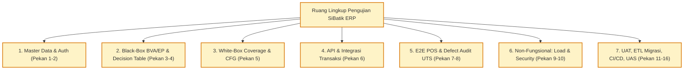
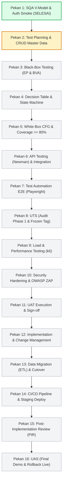

# Master Test Plan (Rencana Induk Pengujian Perangkat Lunak)
**Sistem:** SiBatik ERP (ERP/EIS UMKM Batik Pamekasan)  
**Mata Kuliah:** Manajemen dan Proyek SI (MKB020204)  
**Institusi:** Universitas Islam Madura  
**Standar Acuan:** ISO/IEC/IEEE 29119-3 (Test Documentation & Test Planning)  
**Versi:** 1.0 (Draf Pekan 2)  
**Penanggung Jawab:** Software Engineer & Lead QA Engineer  

---

## 1. Pendahuluan & Ringkasan Eksekutif

Dokumen Rencana Pengujian (*Master Test Plan*) ini merinci strategi, ruang lingkup, kriteria, alokasi sumber daya, dan mitigasi risiko pengujian sistem **SiBatik ERP** selama siklus hidup 16 pekan. Fokus mata kuliah *Manajemen dan Proyek SI* adalah **Penjaminan Mutu Perangkat Lunak (*Software Quality Assurance / SQA*)**, bukan sekadar penyelesaian fitur (*feature completeness*).

Proses bisnis mengadopsi studi kasus operasional dan akuntansi Toko Batik Rumah Merah Lasem (Sulistiono, Hediyanto, & Budiyono, 2026), dengan penekanan khusus pada resolusi kelemahan yang ditemukan penguji:
1. Penanganan kesalahan input redundan/duplikasi data (*duplicate validation*).
2. Mekanisme notifikasi, umpan balik visual (*flash message*), dan status perubahan data yang jelas bagi pengguna.

---

## 2. Ruang Lingkup Pengujian (Test Scope)

### 2.1 Fitur yang Diuji (Features to be Tested)
1. **Autentikasi & RBAC Multi-Peran:** Verifikasi isolasi hak akses 7 peran (`admin`, `pembelian`, `gudang`, `penjualan`, `kasir`, `keuangan`, `eksekutif`) dan pencegahan akses tidak sah (403 Forbidden).
2. **Master Data & Integritas Unik (Pekan 2):**
   - CRUD Vendor bahan batik (kain mori, pewarna tekstil, lilin/malam, canting).
   - CRUD Pelanggan (tipe umum vs reseller grosir).
   - CRUD Gudang (pemisahan gudang batik vs gudang bahan baku).
   - CRUD Master Produk Batik dengan multi-varian ukuran (S, M, L, XL, All Size), motif khas Pamekasan, SKU otomatis unik, harga, dan batas minimum stok (*reorder point*).
   - Deteksi dan pencegahan duplikasi data redundan.
3. **Logika Bisnis & Validasi Batas (Pekan 3 - 5):**
   - Aturan batas nilai kuantitas pesanan (BVA: 1 - 9999) dan diskon (0 - 100%).
   - Matriks Decision Table pada `PricingService` untuk kalkulasi diskon bertingkat reseller.
   - State Machine transisi status PO, SO, Goods Receipt, dan Invoice.
   - Perhitungan HPP (*Harga Pokok Penjualan*) dan Reorder Rules (`app/Services`).
4. **Integrasi Antar-Modul & REST API (Pekan 6 - 7):**
   - PO $\rightarrow$ Goods Receipt $\rightarrow$ Stock Move otomatis $\rightarrow$ Vendor Bill.
   - SO $\rightarrow$ Delivery Order otomatis $\rightarrow$ Pengurangan Stok $\rightarrow$ Customer Invoice.
   - Transaksi kasir Point of Sale (POS) dengan pengurangan stok *real-time*.
   - Keamanan dan respon REST API `/api/v1` (Sanctum Auth).
5. **Kinerja, Beban & Keamanan (Pekan 9 - 10):**
   - Uji beban dashboard EIS dan API dengan k6 (100, 300, 500 VUs).
   - Pemindaian kerentanan OWASP Top 10 (CSRF, XSS, SQLi, IDOR) menggunakan OWASP ZAP.
6. **Migrasi Data & Pemulihan (Pekan 11 - 16):**
   - UAT berstandar ISO 29119-4.
   - Validasi skrip ETL Python pembersih data legacy kotor.
   - Pipeline CI/CD GitHub Actions dan skenario uji rollback cepat.

### 2.2 Fitur yang Tidak Diuji (Out of Scope)
- Fitur akuntansi tingkat lanjut multi-currency dan perpajakan internasional (hanya mata uang IDR & PPh/PPN standar).
- Pembayaran via payment gateway perbankan pihak ketiga secara live (hanya simulasi kasir/tunai dan transfer bank lokal).

---

## 3. Strategi & Tingkat Pengujian (Test Strategy)

Mengacu pada arsitektur **V-Model**:

| Tingkat Uji | Jenis Pengujian | Alat / Framework | Target Objek | Penanggung Jawab |
| :--- | :--- | :--- | :--- | :--- |
| **Unit Testing** | White-Box (CFG, Branch Coverage $\ge 80\%$) | Pest PHP + PCOV | `app/Services/*`, Helper, Model Scope | Developer / QA |
| **Feature / Module Testing** | Black-Box (EP/BVA, Decision Table, State Transition) | Pest Testing Framework | Controller, Form Request, Database Migration, Routing | QA Engineer |
| **API Testing** | Kontrak API, Status Code, Payload Valid/Invalid | Postman + Newman CLI | Endpoint `/api/v1/*` (Sanctum Token) | QA / API Tester |
| **Integration Testing** | Mutasi Stok Atomik, Trigger Transaksional | Pest DB Integration | Alur PO $\rightarrow$ GR, SO $\rightarrow$ DO $\rightarrow$ Faktur | SQA Lead |
| **System E2E Testing** | End-to-End User Journeys (Login, POS, Approval) | Playwright Automation | Seluruh Antarmuka Blade / Browser | Automation QA |
| **Performance Testing** | Load & Stress Testing (Throughput, p95 Latency) | k6 | Dashboard EIS, Endpoint Stok & Order | Performance Tester |
| **Security Testing** | Vulnerability Assessment & Penetration Baseline | OWASP ZAP, Manual Injection | CSRF, SQL Injection, XSS, Policy Authorization | Security QA |
| **UAT** | Scenario-Based Business Acceptance | Matriks UAT & Lembar Berita Acara | Calon Pengguna UMKM (7 Peran) | Pemilik UMKM / Dosen |

---

## 4. Kriteria Keberterimaan (Entry & Exit Criteria)

Sesuai ISO/IEC/IEEE 29119-2:

### 4.1 Entry Criteria (Syarat Memulai Pengujian Tiap Pekan)
1. Seluruh kode fitur pekan bersangkutan telah di-commit ke branch `pekan-XX`.
2. Migrasi database dan seeder dummy berjalan sukses tanpa konflik skema.
3. Tidak ada error sintaksis (*fatal error* atau *unhandled exception*) saat aplikasi di-boot.
4. Lingkungan pengujian terisolasi (Docker Compose atau SQLite In-Memory) tersedia dan siap dieksekusi.

### 4.2 Exit Criteria (Syarat Pengujian Dinyatakan Selesai / Siap Rilis Pekan)
1. **Tingkat Kelulusan Test (Pass Rate):** 100% test case otomatis yang terdaftar berstatus **PASS** (`php artisan test` hijau penuh).
2. **Cakupan Pengujian (Test Coverage):**
   - Unit test pada `app/Services` mencapai minimal **80% Branch Coverage** (diverifikasi pada Pekan 5).
   - Seluruh endpoint API teruji dengan skenario positif dan negatif (Pekan 6).
3. **Ambang Batas Cacat (Defect Threshold):**
   - Cacat berkategori **High / Critical**: 0 bug terbuka (*Zero tolerance*).
   - Cacat berkategori **Medium**: Maksimal 0 bug tak terselesaikan (harus diselesaikan sebelum merge ke `main`).
   - Cacat berkategori **Low**: Boleh tersisa maksimal 2 bug dengan dokumentasi perbaikan terencana di `docs/pekan-XX/defects.md`.
4. **Artefak Terpenuhi:** Dokumen laporan dan artefak RPS pekan tersebut telah disusun rapi di direktori `docs/` dan `qa/`.
5. **Git Versioning:** Branch `pekan-XX` telah di-merge ke `main`, diberi tag git `v0.XX`, dan di-push ke repositori GitHub.

---

## 5. Analisis Risiko Mutu Perangkat Lunak (Quality Risk Matrix)

| ID Risiko | Deskripsi Potensi Risiko | Tingkat Kemungkinan (*Likelihood*) | Dampak (*Impact*) | RPN (*Risk Priority Number*) | Rencana Mitigasi & Pengujian |
| :--- | :--- | :---: | :---: | :---: | :--- |
| **RSK-01** | Terjadi duplikasi data vendor, pelanggan, atau kode SKU varian batik akibat kelalaian input kasir/admin. | Tinggi | Tinggi | **Tinggi (H)** | Menerapkan *Database Unique Index*, validasi Form Request spesifik, deteksi duplikasi nama/telepon di `MasterDataService`, dan Feature Test duplikasi. |
| **RSK-02** | Inkonsistensi stok fisik vs stok sistem (*race condition*) saat kasir POS menjual produk bersamaan dengan Sales Order grosir. | Sedang | Kritis | **Tinggi (H)** | Transaksi database atomik (`DB::transaction`), *Pessimistic Locking* pada mutasi stok, serta Integration Test konkurensi. |
| **RSK-03** | Perhitungan diskon reseller salah sehingga merugikan keuangan UMKM Batik. | Sedang | Tinggi | **Sedang (M)** | Desain matriks Decision Table formal, isolasi perhitungan matematis dalam `PricingService`, dan pengujian 100% aturan tabel keputusan. |
| **RSK-04** | Pengguna bingung saat proses modifikasi data gagal karena tidak adanya pesan kesalahan yang informatif. | Tinggi | Sedang | **Sedang (M)** | Menyediakan *flash alert*, pesan validasi bahasa Indonesia per baris input, dan tooltip status. |
| **RSK-05** | Beban query agregasi dashboard EIS lambat saat data transaksi penjualan membesar. | Sedang | Sedang | **Sedang (M)** | Penerapan *database indexing*, eager loading anti N+1 query, caching agregasi harian, dan load testing k6 hingga 500 VUs. |
| **RSK-06** | Kebocoran data pelanggan/omzet atau akses tidak sah lintas modul antar-karyawan. | Rendah | Kritis | **Tinggi (H)** | Proteksi otorisasi berbasis Policy & Spatie Permission, rate limiting login, audit trail logging, dan scan berkala OWASP ZAP. |

---

## 6. Jadwal & Milestone Pengujian 16 Pekan (Master Schedule)

---

## 7. Lingkungan & Sumber Daya Pengujian (Test Environment)

1. **Hardware / Virtual:**
   - Workstation pengembangan (Windows 11 x64, 16GB RAM).
   - Docker Container Host (Alpine Linux, Nginx, PHP 8.3 FPM, PostgreSQL 16).
2. **Software & Runtime:**
   - Backend: PHP 8.3.36 (CLI & FPM) dengan ekstensi PDO SQLite & PostgreSQL.
   - Database: PostgreSQL 16 (Staging/Docker), SQLite In-Memory (Automated Testing).
   - Frontend Build: Tailwind CSS & Alpine.js CDN.
3. **Alat Pengujian Khusus:**
   - Unit & Feature Test: **Pest PHP 2.x** + Pest Plugin Laravel.
   - Coverage Driver: **PCOV**.
   - API Testing: **Postman v11 + Newman CLI**.
   - E2E Automation: **Playwright Test Runner**.
   - Load Testing: **k6 (Grafana)**.
   - Vulnerability Scanner: **OWASP ZAP 2.15+ (Baseline Scan)**.
   - Defect & Issue Tracker: **GitHub Issues** (label: `bug`, `severity:high|medium|low`).

---

## 8. Persetujuan & Tanda Tangan (Sign-off Plan)

Dokumen ini menjadi acuan mutlak bagi seluruh aktivitas pengujian yang dilaporkan pada setiap rilis mingguan dan diaudit formal pada **Pekan 8 (UTS)** serta **Pekan 16 (UAS)**.
